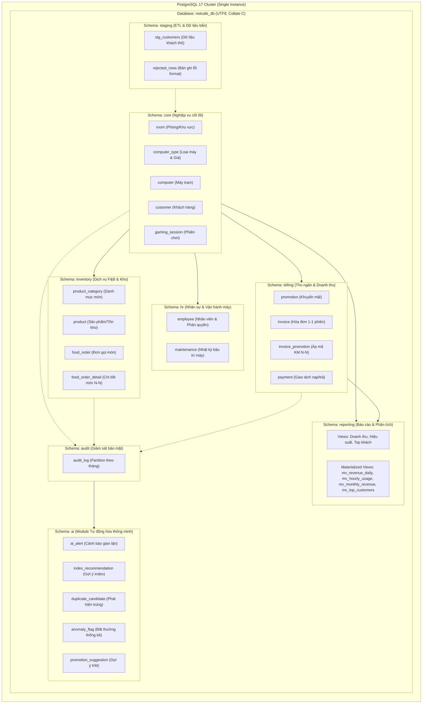

# KIẾN TRÚC LOGIC VÀ MÔ HÌNH CƠ SỞ DỮ LIỆU NETCAFE_DB

> **Môn học:** Quản trị Cơ sở Dữ liệu (QTDL)  
> **Đề tài:** Xây dựng và tối ưu cơ sở dữ liệu cho hệ thống quản lý phòng game/net  
> **Phiên bản PostgreSQL:** 17  

---

## 1. TỔNG QUAN KIẾN TRÚC LOGIC (CLUSTER → DATABASE → SCHEMAS)

Hệ thống được tổ chức theo kiến trúc phân tầng 3 cấp tiêu chuẩn của PostgreSQL:
1. **PostgreSQL Instance (Cluster):** Quản lý tiến trình nền (background workers, WAL writer, checkpointer, autovacuum) và các đối tượng cấp cụm (Global Roles/Users, Tablespaces).
2. **Database `netcafe_db`:** Cơ sở dữ liệu logic độc lập, sử dụng template chuẩn `template0`, bảng mã `UTF8`, collation `C` nhằm đảm bảo tính toàn vẹn và độc lập hoàn toàn với ngôn ngữ/locale của hệ điều hành máy chủ chấm bài.
3. **8 Schemas Chuyên Biệt:** Phân định rõ ràng ranh giới nghiệp vụ (bounded contexts), hỗ trợ cấp quyền bảo mật DCL theo nguyên tắc đặc quyền tối thiểu (Least Privilege), và cô lập bảng tạm/báo cáo khỏi nghiệp vụ cốt lõi.

---

## 2. DANH SÁCH BẢNG VÀ PHÂN LOẠI CHI TIẾT (22 BẢNG)

Hệ thống bao gồm **16 bảng nghiệp vụ chính** + **6 bảng giám sát/AI hỗ trợ**. Ngoài ra còn có bảng cấu hình station, hai bảng `staging.*` phục vụ ETL và các partition của `audit.audit_log`; các view/materialized view báo cáo được quản lý riêng trong schema `reporting`.

### 2.1. Schema `core` (6 bảng)
1. **`core.room` (Phòng/Khu vực):**
   - **PK:** `room_id INT GENERATED ALWAYS AS IDENTITY`
   - **Thuộc tính:** `room_name VARCHAR(50) UNIQUE`, `description TEXT`
   - **Mục đích:** Phân loại không gian quán (Khu hút thuốc, Khu máy lạnh, Phòng Stream, Phòng Thi đấu).
   - *Lý do thiết kế:* Tách phòng giúp quản lý cơ sở vật chất và phân bổ máy trực quan.

2. **`core.computer_type` (Loại máy & Đơn giá):**
   - **PK:** `type_id INT GENERATED ALWAYS AS IDENTITY`
   - **Thuộc tính:** `type_name VARCHAR(50) UNIQUE`, `hourly_rate NUMERIC(12,0) CHECK (hourly_rate >= 0)`
   - **Mục đích:** Quy định các hạng cấu hình máy (Thường, VIP, Thi Đấu, Ghế Đôi) và mức giá thuê/giờ mặc định.
   - *Lý do thiết kế (Câu hỏi bảo vệ):* Giá/giờ đặt ở `computer_type` thay vì `computer` để đạt chuẩn hóa **3NF (Third Normal Form)**; tránh dị thường cập nhật (Update Anomaly) khi thay đổi giá cho toàn bộ dàn máy cùng loại.

3. **`core.computer` (Máy trạm):**
   - **PK:** `computer_id INT GENERATED ALWAYS AS IDENTITY`
   - **Thuộc tính:** `computer_code VARCHAR(20) UNIQUE`, `computer_name VARCHAR(50)`, `room_id INT FK`, `type_id INT FK`, `specs JSONB`, `ip_address INET UNIQUE`, `mac_address MACADDR UNIQUE`, `status VARCHAR(20) CHECK IN ('available','in_use','maintenance','broken')`, `purchased_at DATE`, `created_at TIMESTAMPTZ`
   - **Mục đích:** Quản lý từng máy trạm cụ thể trong phòng net, địa chỉ mạng trong LAN, và thông số phần cứng.
   - *Lý do thiết kế:* Sử dụng kiểu `INET` và `MACADDR` có sẵn của PostgreSQL để kiểm tra hợp lệ địa chỉ IP/MAC mạng LAN tự động ở tầng CSDL; `specs JSONB` lưu cấu hình CPU/RAM/VGA linh hoạt mà không cần thêm cột khi nâng cấp máy.

4. **`core.customer` (Khách hàng / Hội viên):**
   - **PK:** `customer_id INT GENERATED ALWAYS AS IDENTITY`
   - **Thuộc tính:** `full_name VARCHAR(100)`, `phone VARCHAR(15) UNIQUE`, `email VARCHAR(100) UNIQUE`, `username VARCHAR(50) UNIQUE`, `password_hash VARCHAR(255)`, `balance NUMERIC(12,0) DEFAULT 0 CHECK (balance >= 0)`, `loyalty_points INT DEFAULT 0 CHECK (loyalty_points >= 0)`, `membership_tier VARCHAR(20) CHECK IN ('regular','silver','gold','vip')`, `is_active BOOLEAN`, `created_at TIMESTAMPTZ`
   - **Mục đích:** Quản lý tài khoản hội viên, số dư nạp tiền trả trước, điểm tích lũy và cấp độ ưu đãi.
   - *Lý do thiết kế:* `balance` dùng `NUMERIC(12,0)` kèm ràng buộc `CHECK (balance >= 0)` để đảm bảo tính bất biến: tài khoản trả trước phòng net không bao giờ bị âm tiền ở bất kỳ kịch bản nào.

5. **`core.gaming_session` (Phiên chơi máy - Bảng trung tâm):**
   - **PK:** `session_id BIGINT GENERATED ALWAYS AS IDENTITY`
   - **Thuộc tính:** `customer_id INT FK`, `computer_id INT FK`, `opened_by INT FK (employee)`, `start_time TIMESTAMPTZ`, `end_time TIMESTAMPTZ NULL`, `status VARCHAR(20) CHECK IN ('active','finished','cancelled')`, `hourly_rate_applied NUMERIC(12,0) CHECK (hourly_rate_applied >= 0)`, `play_amount NUMERIC(12,0) NULL CHECK (play_amount >= 0)`, `game_info JSONB`
   - **Ràng buộc:** `CHECK (end_time IS NULL OR end_time > start_time)`, `CHECK ((status = 'active' AND end_time IS NULL) OR (status <> 'active' AND end_time IS NOT NULL))`
   - *Lý do thiết kế:* Lưu `hourly_rate_applied` tại thời điểm mở máy nhằm bảo toàn dữ liệu lịch sử nếu sau này bảng giá phòng net thay đổi; không lưu cột thời lượng `duration` thừa để tránh vi phạm chuẩn hóa và không đồng bộ, thời lượng được tính tự động bằng hàm/view (`EXTRACT(EPOCH FROM (end_time - start_time))`).

---

### 2.2. Schema `inventory` (4 bảng)
7. **`inventory.product_category` (Danh mục đồ ăn/uống):**
   - **PK:** `category_id INT GENERATED ALWAYS AS IDENTITY`
   - **Thuộc tính:** `category_name VARCHAR(50) UNIQUE`
   - **Mục đích:** Phân loại đồ ăn nhanh, nước ngọt, thẻ game, snack.

8. **`inventory.product` (Sản phẩm / Dịch vụ F&B):**
   - **PK:** `product_id INT GENERATED ALWAYS AS IDENTITY`
   - **Thuộc tính:** `sku VARCHAR(30) UNIQUE`, `product_name VARCHAR(100)`, `category_id INT FK`, `unit_price NUMERIC(12,0) CHECK (unit_price >= 0)`, `stock_qty INT CHECK (stock_qty >= 0)`, `attributes JSONB`, `is_active BOOLEAN`
   - **Mục đích:** Danh mục hàng hóa và tồn kho. Ràng buộc `stock_qty >= 0` ngăn chặn việc bán quá số lượng có sẵn trong kho ngay tại CSDL.

9. **`inventory.food_order` (Đơn đặt món):**
   - **PK:** `order_id BIGINT GENERATED ALWAYS AS IDENTITY`
   - **Thuộc tính:** `session_id BIGINT FK (gaming_session)`, `employee_id INT FK (employee phục vụ)`, `ordered_at TIMESTAMPTZ`, `status VARCHAR(20) CHECK IN ('placed','served','cancelled')`
   - **Mục đích:** Gắn kết dịch vụ đồ ăn uống trực tiếp với phiên máy đang chơi.

10. **`inventory.food_order_detail` (Chi tiết đơn gọi món - Quan hệ N-N):**
    - **PK:** `(order_id, product_id)`
    - **Thuộc tính:** `order_id BIGINT FK`, `product_id INT FK`, `quantity INT CHECK (quantity > 0)`, `unit_price NUMERIC(12,0) CHECK (unit_price >= 0)`
    - *Lý do thiết kế:* Chốt giá bán `unit_price` tại thời điểm tạo đơn nhằm tránh trường hợp sản phẩm tăng/giảm giá làm sai lệch doanh thu lịch sử; làm bảng cầu nối N-N giữa đơn gọi món và sản phẩm.

---

### 2.3. Schema `billing` (4 bảng)
11. **`billing.promotion` (Chương trình khuyến mãi):**
    - **PK:** `promotion_id INT GENERATED ALWAYS AS IDENTITY`
    - **Thuộc tính:** `code VARCHAR(30) UNIQUE`, `promotion_name VARCHAR(100)`, `promo_type VARCHAR(20) CHECK IN ('percent','fixed','free_hours','happy_hour')`, `value NUMERIC(12,2) CHECK (value >= 0)`, `valid_from TIMESTAMPTZ`, `valid_to TIMESTAMPTZ`, `conditions JSONB`, `is_active BOOLEAN`
    - **Ràng buộc:** `CHECK (valid_to >= valid_from)`
    - *Lý do thiết kế:* Sử dụng cột `conditions JSONB` để lưu điều kiện động (ví dụ: `{"min_hours": 3, "required_tier": "gold", "time_window": "22:00-06:00"}`) giúp schema linh hoạt, không cần tạo thêm nhiều bảng cấu hình rườm rà.

12. **`billing.invoice` (Hóa đơn thanh toán - Quan hệ 1-1 với phiên):**
    - **PK:** `invoice_id BIGINT GENERATED ALWAYS AS IDENTITY`
    - **Thuộc tính:** `session_id BIGINT UNIQUE FK (gaming_session)`, `customer_id INT FK`, `cashier_id INT FK (employee)`, `play_amount NUMERIC(12,0) DEFAULT 0 CHECK (play_amount >= 0)`, `service_amount NUMERIC(12,0) DEFAULT 0 CHECK (service_amount >= 0)`, `surcharge NUMERIC(12,0) DEFAULT 0 CHECK (surcharge >= 0)`, `discount_amount NUMERIC(12,0) DEFAULT 0 CHECK (discount_amount >= 0)`, `total_amount NUMERIC(12,0) CHECK (total_amount >= 0)`, `status VARCHAR(20) CHECK IN ('unpaid','paid','void')`, `issued_at TIMESTAMPTZ`, `paid_at TIMESTAMPTZ NULL`
    - **Ràng buộc:** `CHECK (total_amount = play_amount + service_amount + surcharge - discount_amount)`
    - *Lý do thiết kế (Câu hỏi bảo vệ):* `session_id` có ràng buộc `UNIQUE` thiết lập quan hệ **1-1 bắt buộc**: mỗi phiên chơi sau khi kết thúc chỉ tương ứng với duy nhất một hóa đơn, ngăn ngừa việc thanh toán lặp hoặc xuất hóa đơn khống. Công thức `total_amount` được khóa cứng bằng `CHECK constraint`.

13. **`billing.invoice_promotion` (Chi tiết khuyến mãi áp dụng - Quan hệ N-N):**
    - **PK:** `(invoice_id, promotion_id)`
    - **Thuộc tính:** `invoice_id BIGINT FK`, `promotion_id INT FK`, `discount_amount NUMERIC(12,0) CHECK (discount_amount >= 0)`
    - **Mục đích:** Lưu vết một hóa đơn có thể được hưởng nhiều mã khuyến mãi (ví dụ: Happy Hour + Giảm giá hội viên Gold).

14. **`billing.payment` (Nhật ký giao dịch thanh toán):**
    - **PK:** `payment_id BIGINT GENERATED ALWAYS AS IDENTITY`
    - **Thuộc tính:** `kind VARCHAR(20) CHECK IN ('invoice','topup')`, `invoice_id BIGINT NULL FK`, `customer_id INT FK`, `method VARCHAR(20) CHECK IN ('balance','cash','bank_transfer','card')`, `amount NUMERIC(12,0) CHECK (amount > 0)`, `employee_id INT FK`, `paid_at TIMESTAMPTZ`, `reference VARCHAR(100)`
    - **Ràng buộc:** `CHECK ((kind = 'invoice' AND invoice_id IS NOT NULL) OR (kind = 'topup' AND invoice_id IS NULL))`
    - *Lý do thiết kế:* Thống nhất mọi dòng tiền thu vào (Tiền thanh toán hóa đơn hoặc Tiền khách nạp vào tài khoản) trong một bảng duy nhất, ràng buộc nghiệp vụ đảm bảo nếu là thanh toán hóa đơn thì bắt buộc phải gắn `invoice_id`, nạp tiền thì `invoice_id` là `NULL`.

---

### 2.4. Schema `hr` (2 bảng)
15. **`hr.employee` (Nhân sự & Tài khoản hệ thống):**
    - **PK:** `employee_id INT GENERATED ALWAYS AS IDENTITY`
    - **Thuộc tính:** `full_name VARCHAR(100)`, `phone VARCHAR(15)`, `username VARCHAR(50) UNIQUE`, `db_username VARCHAR(50) UNIQUE NULL`, `password_hash VARCHAR(255)`, `emp_role VARCHAR(20) CHECK IN ('admin','manager','cashier','staff','technician')`, `default_shift VARCHAR(20) CHECK IN ('morning','afternoon','night')`, `salary NUMERIC(12,0) CHECK (salary >= 0)`, `hired_date DATE`, `is_active BOOLEAN`
    - *Lý do thiết kế:* Cột `db_username` ánh xạ trực tiếp tài khoản nhân viên ứng dụng sang `Database Role` của PostgreSQL (ví dụ `nv_an` map với `role_cashier`), là nền tảng cốt lõi để triển khai cơ chế **Row-Level Security (RLS)** và **Column-Level Privileges**. Cột `salary` là dữ liệu nhạy cảm được bảo vệ bằng DCL.

16. **`hr.maintenance` (Nhật ký bảo trì thiết bị):**
    - **PK:** `maintenance_id INT GENERATED ALWAYS AS IDENTITY`
    - **Thuộc tính:** `computer_id INT FK`, `technician_id INT FK (employee)`, `issue_description TEXT`, `started_at TIMESTAMPTZ`, `finished_at TIMESTAMPTZ NULL`, `cost NUMERIC(12,0) DEFAULT 0 CHECK (cost >= 0)`, `parts_replaced JSONB`, `status VARCHAR(20) CHECK IN ('reported','in_progress','fixed','unrepairable')`
    - **Ràng buộc:** `CHECK (finished_at IS NULL OR finished_at >= started_at)`
    - *Lý do thiết kế:* `parts_replaced JSONB` cho phép kỹ thuật viên ghi nhận linh hoạt danh sách linh kiện thay thế kèm số serial/giá (ví dụ: `[{"part": "RAM Kingston 8GB", "qty": 1, "sn": "SN89123"}]`).

---

### 2.5. Schema `audit` (1 bảng Partition)
17. **`audit.audit_log` (Nhật ký kiểm toán an toàn thông tin):**
    - **PK:** `(audit_id, logged_at)`
    - **Thuộc tính:** `audit_id BIGINT GENERATED ALWAYS AS IDENTITY`, `logged_at TIMESTAMPTZ DEFAULT clock_timestamp()`, `actor VARCHAR(50)`, `table_name VARCHAR(50)`, `action VARCHAR(10)`, `row_pk VARCHAR(50)`, `old_data JSONB`, `new_data JSONB`
    - **Phân vùng (Partitioning):** `PARTITION BY RANGE (logged_at)` kèm các partition theo tháng và partition `DEFAULT`.
    - *Lý do thiết kế (Câu hỏi bảo vệ):* Bảng audit tăng trưởng dữ liệu rất nhanh theo thời gian. Việc phân vùng theo tháng (`RANGE`) giúp tối ưu hiệu năng ghi, cho phép truy vấn kiểm toán pruning chính xác theo khoảng ngày, và dễ dàng dọn dẹp dữ liệu cũ (`DETACH PARTITION` / `DROP TABLE`) theo chính sách lưu trữ (retention policy) mà không gây khóa bảng tổng.

---

### 2.6. Schema `ai` (5 bảng Tự động hóa thông minh)
18. **`ai.ai_alert` (Cảnh báo gian lận & Rủi ro bảo mật - Module 1):**
    - **PK:** `alert_id INT GENERATED ALWAYS AS IDENTITY`
    - **Thuộc tính:** `audit_id BIGINT`, `audit_logged_at TIMESTAMPTZ`, `risk_score INT CHECK (risk_score BETWEEN 0 AND 100)`, `risk_level VARCHAR(10) CHECK IN ('low','medium','high')`, `reason TEXT`, `status VARCHAR(20) DEFAULT 'new' CHECK IN ('new','reviewed')`, `created_at TIMESTAMPTZ DEFAULT now()`
    - **Mục đích:** Ghi nhận các cảnh báo được sinh ra từ Trigger phân tích Audit (ví dụ: nhân viên thường tự sửa số dư, hủy hóa đơn giờ đêm, đổi lương).

19. **`ai.index_recommendation` (Tư vấn tối ưu hóa Index tự động - Module 2):**
    - **PK:** `rec_id INT GENERATED ALWAYS AS IDENTITY`
    - **Thuộc tính:** `table_name VARCHAR(100)`, `column_list VARCHAR(255)`, `reason TEXT`, `suggested_sql TEXT`, `created_at TIMESTAMPTZ DEFAULT now()`
    - **Mục đích:** Lưu trữ các đề xuất tạo index do hàm DBA tự động sinh ra khi phân tích thống kê `pg_stat_user_tables` (Seq Scan cao, thiếu index FK).

20. **`ai.duplicate_candidate` (Gắn cờ khách hàng trùng lặp - Module 3):**
    - **PK:** `cand_id INT GENERATED ALWAYS AS IDENTITY`
    - **Thuộc tính:** `customer_id_a INT FK`, `customer_id_b INT FK`, `similarity NUMERIC(4,3)`, `reason TEXT`, `status VARCHAR(20) DEFAULT 'pending' CHECK IN ('pending','merged','ignored')`, `created_at TIMESTAMPTZ DEFAULT now()`
    - **Mục đích:** Tự động phát hiện các cặp khách hàng nghi vấn trùng lặp danh tính bằng thuật toán trigram (`similarity` từ extension `pg_trgm`).

21. **`ai.anomaly_flag` (Phát hiện bất thường thống kê - Module 4):**
    - **PK:** `flag_id INT GENERATED ALWAYS AS IDENTITY`
    - **Thuộc tính:** `anomaly_type VARCHAR(50)`, `subject_table VARCHAR(50)`, `subject_pk VARCHAR(50)`, `metric_value NUMERIC(15,2)`, `threshold_info JSONB`, `detected_at TIMESTAMPTZ DEFAULT now()`, `status VARCHAR(20) DEFAULT 'open' CHECK IN ('open','resolved')`
    - **Mục đích:** Gắn cờ các phiên chơi bất thường (quên đóng phiên > 24h, tiền nạp đột biến > 3 lần độ lệch chuẩn Z-score).

22. **`ai.promotion_suggestion` (Gợi ý khung giờ khuyến mãi & Phân khúc - Module 5):**
    - **PK:** `sug_id INT GENERATED ALWAYS AS IDENTITY`
    - **Thuộc tính:** `suggestion_type VARCHAR(50)`, `target VARCHAR(100)`, `details JSONB`, `created_at TIMESTAMPTZ DEFAULT now()`
    - **Mục đích:** Lưu trữ gợi ý chạy chiến dịch khuyến mãi (khung giờ vắng khách Happy Hour hoặc danh sách khách hàng VIP cần chăm sóc qua phân tích RFM).

---

## 3. BẢNG TỔNG HỢP CÁC LOẠI QUAN HỆ TRONG HỆ THỐNG

| Quan hệ | Bảng 1 | Bảng 2 | Cơ chế thể hiện trong CSDL | Ý nghĩa nghiệp vụ |
| :--- | :--- | :--- | :--- | :--- |
| **1 - 1** | `core.gaming_session` | `billing.invoice` | `invoice.session_id` là **FK + UNIQUE** | Mỗi phiên chơi có đúng 1 hóa đơn thanh toán duy nhất. |
| **1 - N** | `core.room` | `core.computer` | `computer.room_id` FK | Một phòng chứa nhiều máy; mỗi máy thuộc một phòng. |
| **1 - N** | `core.computer_type` | `core.computer` | `computer.type_id` FK | Một loại cấu hình áp dụng cho nhiều máy. |
| **1 - N** | `core.customer` | `core.gaming_session` | `gaming_session.customer_id` FK | Một khách hàng trải qua nhiều phiên chơi. |
| **1 - N** | `core.computer` | `core.gaming_session` | `gaming_session.computer_id` FK | Một máy phục vụ nhiều phiên chơi theo thời gian. |
| **1 - N** | `hr.employee` | `core.gaming_session` | `gaming_session.opened_by` FK | Một nhân viên mở nhiều phiên cho khách. |
| **1 - N** | `inventory.product_category` | `inventory.product` | `product.category_id` FK | Một danh mục chứa nhiều sản phẩm. |
| **1 - N** | `core.gaming_session` | `inventory.food_order` | `food_order.session_id` FK | Một phiên chơi có thể gọi nhiều lượt đồ ăn uống. |
| **1 - N** | `core.customer` | `billing.invoice` | `invoice.customer_id` FK | Một khách nhận nhiều hóa đơn. |
| **1 - N** | `hr.employee` | `billing.invoice` | `invoice.cashier_id` FK | Một thu ngân xuất nhiều hóa đơn. |
| **1 - N** | `billing.invoice` | `billing.payment` | `payment.invoice_id` FK (NULLable) | Một hóa đơn có thể thanh toán bằng giao dịch. |
| **1 - N** | `core.customer` | `billing.payment` | `payment.customer_id` FK | Một khách có nhiều giao dịch nạp/thanh toán. |
| **1 - N** | `core.computer` | `hr.maintenance` | `maintenance.computer_id` FK | Một máy có lịch sử nhiều lần bảo trì. |
| **1 - N** | `hr.employee` | `hr.maintenance` | `maintenance.technician_id` FK | Kỹ thuật viên phụ trách nhiều ca bảo trì. |
| **N - N** | `inventory.food_order` | `inventory.product` | Cầu nối: `inventory.food_order_detail` (PK ghép) | Một đơn có nhiều món; một món xuất hiện trong nhiều đơn. |
| **N - N** | `billing.invoice` | `billing.promotion` | Cầu nối: `billing.invoice_promotion` (PK ghép) | Một hóa đơn áp dụng nhiều khuyến mãi; một khuyến mãi dùng cho nhiều hóa đơn. |

---

## 4. QUY TẮC RÀNG BUỘC TOÀN VẸN THAM CHIẾU (ON DELETE RESTRICT)

Tất cả các Foreign Key (FK) trong hệ thống đều được định nghĩa với quy tắc:
$$\text{ON DELETE RESTRICT}$$

**Giải thích vì sao cho hội đồng bảo vệ:**
1. **Bảo toàn tính kế toán và pháp lý của dữ liệu:** Không được phép xóa phòng (`room`), loại máy (`computer_type`), khách hàng (`customer`), nhân viên (`employee`) hay sản phẩm (`product`) nếu các thực thể này đã phát sinh giao dịch trong lịch sử (hóa đơn, phiên chơi, thanh toán).
2. **Ngăn chặn hiệu ứng xóa dây chuyền vô tình (Cascading Disasters):** Việc dùng `CASCADE` trong hệ thống tài chính/vận hành phòng game có thể khiến một câu lệnh vô tình xóa 1 nhân viên dẫn đến xóa sạch hàng triệu dòng lịch sử phiên chơi và hóa đơn liên quan.
3. **Mô hình Soft Delete:** Nếu ngừng hoạt động một máy, sản phẩm hoặc nhân viên, hệ thống cập nhật cờ logic (`is_active = FALSE` hoặc `status = 'broken'/'retired'`) thay vì xóa vật lý khỏi bảng.
