# ERD đầy đủ phục vụ bảo vệ NetCafe

Đối chiếu metadata Neon ngày 29/10/2026: 25 bảng logic, 183 cột. Partition con được thể hiện bằng bảng cha audit.audit_log; view và materialized view không phải bảng nghiệp vụ.

Ký hiệu PK là khóa chính, FK là khóa ngoại, UK là ràng buộc duy nhất một cột. Mỗi phiên có tối đa một hóa đơn; không suy ra mọi phiên đã có hóa đơn.

```mermaid
erDiagram
    AI_AI_ALERT {
        integer alert_id PK
        bigint audit_id
        timestamp_with_time_zone audit_logged_at
        integer risk_score
        character_varying_10 risk_level
        text reason
        character_varying_20 status
        timestamp_with_time_zone created_at
    }
    AI_ANOMALY_FLAG {
        integer flag_id PK
        character_varying_50 anomaly_type
        character_varying_50 subject_table
        character_varying_50 subject_pk
        numeric_15_2 metric_value
        jsonb threshold_info
        timestamp_with_time_zone detected_at
        character_varying_20 status
    }
    AI_DUPLICATE_CANDIDATE {
        integer cand_id PK
        integer customer_id_a FK
        integer customer_id_b FK
        numeric_4_3 similarity
        text reason
        character_varying_20 status
        timestamp_with_time_zone created_at
    }
    AI_INDEX_RECOMMENDATION {
        integer rec_id PK
        character_varying_100 table_name
        character_varying_255 column_list
        text reason
        text suggested_sql
        timestamp_with_time_zone created_at
    }
    AI_PROMOTION_SUGGESTION {
        integer sug_id PK
        character_varying_50 suggestion_type
        character_varying_100 target
        jsonb details
        timestamp_with_time_zone created_at
    }
    AUDIT_AUDIT_LOG {
        bigint audit_id PK
        timestamp_with_time_zone logged_at PK
        character_varying_50 actor
        character_varying_50 table_name
        character_varying_10 action
        character_varying_50 row_pk
        jsonb old_data
        jsonb new_data
    }
    BILLING_INVOICE {
        bigint invoice_id PK
        bigint session_id FK, UK
        integer customer_id FK
        integer cashier_id FK
        numeric_12_0 play_amount
        numeric_12_0 service_amount
        numeric_12_0 surcharge
        numeric_12_0 discount_amount
        numeric_12_0 total_amount
        character_varying_20 status
        timestamp_with_time_zone issued_at
        timestamp_with_time_zone paid_at
    }
    BILLING_INVOICE_PROMOTION {
        bigint invoice_id PK, FK
        integer promotion_id PK, FK
        numeric_12_0 discount_amount
    }
    BILLING_PAYMENT {
        bigint payment_id PK
        character_varying_20 kind
        bigint invoice_id FK
        integer customer_id FK
        character_varying_20 method
        numeric_12_0 amount
        integer employee_id FK
        timestamp_with_time_zone paid_at
        character_varying_100 reference
    }
    BILLING_PROMOTION {
        integer promotion_id PK
        character_varying_30 code UK
        character_varying_100 promotion_name
        character_varying_20 promo_type
        numeric_12_2 value
        timestamp_with_time_zone valid_from
        timestamp_with_time_zone valid_to
        jsonb conditions
        boolean is_active
    }
    CORE_COMPUTER {
        integer computer_id PK
        character_varying_20 computer_code UK
        character_varying_50 computer_name
        integer room_id FK
        integer type_id FK
        jsonb specs
        inet ip_address UK
        macaddr mac_address UK
        character_varying_20 status
        date purchased_at
        timestamp_with_time_zone created_at
    }
    CORE_COMPUTER_TYPE {
        integer type_id PK
        character_varying_50 type_name UK
        numeric_12_0 hourly_rate
    }
    CORE_CUSTOMER {
        integer customer_id PK
        character_varying_100 full_name
        character_varying_15 phone UK
        character_varying_100 email UK
        character_varying_50 username UK
        character_varying_255 password_hash
        numeric_12_0 balance
        integer loyalty_points
        character_varying_20 membership_tier
        boolean is_active
        timestamp_with_time_zone created_at
    }
    CORE_GAMING_SESSION {
        bigint session_id PK
        integer customer_id FK
        integer computer_id FK
        integer opened_by FK
        timestamp_with_time_zone start_time
        timestamp_with_time_zone end_time
        character_varying_20 status
        numeric_12_0 hourly_rate_applied
        numeric_12_0 play_amount
        jsonb game_info
        timestamp_with_time_zone last_heartbeat_at
        character_varying_40 close_reason
    }
    CORE_ROOM {
        integer room_id PK
        character_varying_50 room_name UK
        text description
    }
    CORE_SERVICE_REQUEST {
        bigint service_request_id PK
        bigint session_id FK
        integer customer_id FK
        integer computer_id FK
        character_varying_30 request_type
        text message
        character_varying_20 status
        timestamp_with_time_zone created_at
        timestamp_with_time_zone acknowledged_at
        timestamp_with_time_zone resolved_at
        integer handled_by FK
    }
    CORE_STATION_RUNTIME_CONFIG {
        character_varying_50 config_key PK
        text config_value
        timestamp_with_time_zone updated_at
    }
    HR_EMPLOYEE {
        integer employee_id PK
        character_varying_100 full_name
        character_varying_15 phone
        character_varying_50 username UK
        character_varying_50 db_username UK
        character_varying_255 password_hash
        character_varying_20 emp_role
        character_varying_20 default_shift
        numeric_12_0 salary
        date hired_date
        boolean is_active
    }
    HR_MAINTENANCE {
        integer maintenance_id PK
        integer computer_id FK
        integer technician_id FK
        text issue_description
        timestamp_with_time_zone started_at
        timestamp_with_time_zone finished_at
        numeric_12_0 cost
        jsonb parts_replaced
        character_varying_20 status
    }
    INVENTORY_FOOD_ORDER {
        bigint order_id PK
        bigint session_id FK
        integer employee_id FK
        timestamp_with_time_zone ordered_at
        character_varying_20 status
    }
    INVENTORY_FOOD_ORDER_DETAIL {
        bigint order_id PK, FK
        integer product_id PK, FK
        integer quantity
        numeric_12_0 unit_price
    }
    INVENTORY_PRODUCT {
        integer product_id PK
        character_varying_30 sku UK
        character_varying_100 product_name
        integer category_id FK
        numeric_12_0 unit_price
        integer stock_qty
        jsonb attributes
        boolean is_active
    }
    INVENTORY_PRODUCT_CATEGORY {
        integer category_id PK
        character_varying_50 category_name UK
    }
    STAGING_REJECTED_ROWS {
        integer rejected_id PK
        character_varying_50 source_table
        jsonb raw_record
        text error_reason
        timestamp_with_time_zone rejected_at
    }
    STAGING_STG_CUSTOMERS {
        integer raw_id PK
        text raw_full_name
        text raw_phone
        text raw_email
        text raw_username
        text raw_balance
        text raw_points
        text raw_tier
        character_varying_50 source_batch
        timestamp_with_time_zone loaded_at
    }
    CORE_CUSTOMER ||--o{ AI_DUPLICATE_CANDIDATE : "customer_id_a"
    CORE_CUSTOMER ||--o{ AI_DUPLICATE_CANDIDATE : "customer_id_b"
    CORE_GAMING_SESSION ||--o| BILLING_INVOICE : "session_id"
    HR_EMPLOYEE ||--o{ BILLING_INVOICE : "cashier_id"
    CORE_CUSTOMER ||--o{ BILLING_INVOICE : "customer_id"
    BILLING_INVOICE ||--o{ BILLING_INVOICE_PROMOTION : "invoice_id"
    BILLING_PROMOTION ||--o{ BILLING_INVOICE_PROMOTION : "promotion_id"
    CORE_CUSTOMER ||--o{ BILLING_PAYMENT : "customer_id"
    HR_EMPLOYEE ||--o{ BILLING_PAYMENT : "employee_id"
    BILLING_INVOICE o|--o{ BILLING_PAYMENT : "invoice_id"
    CORE_ROOM ||--o{ CORE_COMPUTER : "room_id"
    CORE_COMPUTER_TYPE ||--o{ CORE_COMPUTER : "type_id"
    CORE_COMPUTER ||--o{ CORE_GAMING_SESSION : "computer_id"
    CORE_CUSTOMER ||--o{ CORE_GAMING_SESSION : "customer_id"
    HR_EMPLOYEE ||--o{ CORE_GAMING_SESSION : "opened_by"
    CORE_COMPUTER ||--o{ CORE_SERVICE_REQUEST : "computer_id"
    CORE_CUSTOMER o|--o{ CORE_SERVICE_REQUEST : "customer_id"
    HR_EMPLOYEE o|--o{ CORE_SERVICE_REQUEST : "handled_by"
    CORE_GAMING_SESSION o|--o{ CORE_SERVICE_REQUEST : "session_id"
    CORE_COMPUTER ||--o{ HR_MAINTENANCE : "computer_id"
    HR_EMPLOYEE ||--o{ HR_MAINTENANCE : "technician_id"
    HR_EMPLOYEE ||--o{ INVENTORY_FOOD_ORDER : "employee_id"
    CORE_GAMING_SESSION ||--o{ INVENTORY_FOOD_ORDER : "session_id"
    INVENTORY_FOOD_ORDER ||--o{ INVENTORY_FOOD_ORDER_DETAIL : "order_id"
    INVENTORY_PRODUCT ||--o{ INVENTORY_FOOD_ORDER_DETAIL : "product_id"
    INVENTORY_PRODUCT_CATEGORY ||--o{ INVENTORY_PRODUCT : "category_id"
```

Nguồn thiết kế: sql/01_schema.sql và sql/08_station_customer.sql. Các thay đổi quyền ở migration 14 không thay đổi cấu trúc bảng.
